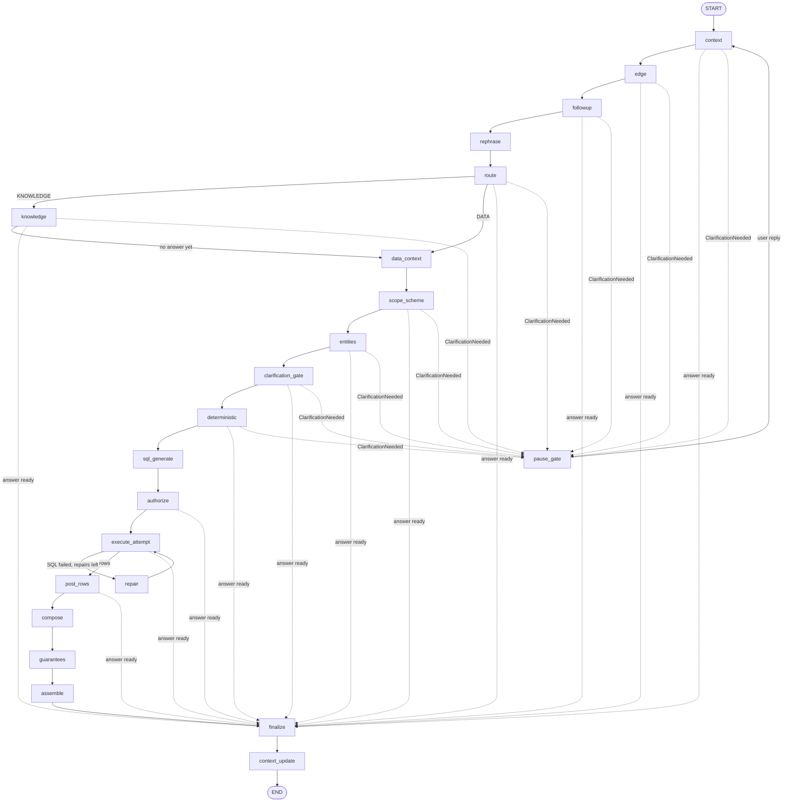

# Meghalaya NL Assistant (Megh One AI): the LangGraph orchestrator, step by step

This README explains **what** the LangGraph orchestrator is, **why** this project uses it, **where**
each piece lives, **how to build it step by step**, and **how every workflow runs** through it, from
the user's question to the database and back to the answer.

It is written so that a developer (or Claude) who has never seen the code can rebuild the
orchestrator, change it safely, and debug it.

All paths are relative to this `meghalaya/` folder. The deeper visual guide is
`../documents/LangGraph_Guide.docx`; the long-form reference is `../documents/README.md`; slow-request
analysis is in `../documents/readme.efficiency.md`.

---

## Contents

1. [What we are building and why](#1-what-we-are-building-and-why)
2. [The architecture in one picture](#2-the-architecture-in-one-picture)
3. [Where everything lives](#3-where-everything-lives)
4. [Before you start](#4-before-you-start)
5. [Build it step by step](#5-build-it-step-by-step)
6. [The 22 nodes](#6-the-22-nodes)
7. [All workflows](#7-all-workflows)
8. [The graph state](#8-the-graph-state)
9. [Errors: what the user sees](#9-errors-what-the-user-sees)
10. [Checkpointing: two stores, two jobs](#10-checkpointing-two-stores-two-jobs)
11. [Configuration fields](#11-configuration-fields)
12. [Logs and health](#12-logs-and-health)
13. [Performance and latency](#13-performance-and-latency)
14. [Testing](#14-testing)
15. [Rollout history](#15-rollout-history)
16. [Adding a new node later](#16-adding-a-new-node-later)
17. [Rules to never break](#17-rules-to-never-break)
18. [Glossary](#18-glossary)

---

## 1. What we are building and why

### 1.1 The application

One FastAPI service (`app/`) answers natural-language questions about six Meghalaya scheme datasets:
**MGNREGA, PMAY-G, Focus Plus, Focus Legacy, CM Elevate, CM Elevate Legacy**.

| Kind of question | Example | How it is answered |
|---|---|---|
| **DATA** | "How many houses were sanctioned under PMAY-G in East Khasi Hills in 2023-24?" | Generate a read-only SQL query on `megh_db`, run it, write a sentence from the rows |
| **KNOWLEDGE** | "Who is eligible for CM Elevate?" | Search the reference documents in Qdrant (RAG) and answer from them |
| **Edge** | "hello", "what is a block?", harmful input | A fixed reply, usually no model call |

### 1.2 The problem

Originally one long function (`_run_pipeline`, now removed) ran every step in a fixed order:
read the conversation context → edge cases → rewrite a follow-up → classify intent → RAG **or**
scheme → entities → SQL → run → repair → compose. It worked, but:

- the order of steps was hidden inside thousands of lines;
- a clarification ("Which district?") was an exception, not a real, resumable pause;
- the SQL repair loop was buried in a `for` loop;
- there was no per-step record of what ran, how long it took and what it decided.

### 1.3 The solution: LangGraph for orchestration only

We split that function **word for word** into small **stage functions**, and LangGraph runs those
stages as **22 nodes** joined by **edges**. LangGraph is now the **only** orchestrator: the old
sequential driver was removed on 2026-10-06 (D-036).

| LangGraph DOES | LangGraph does NOT |
|---|---|
| Decide the order of the steps (nodes and edges) | Call AI models (still raw `httpx` in `app/llm.py`) |
| Write one log record per node (shapes and timings, never data) | Hold business logic (each node is a thin wrapper) |
| Run the SQL repair loop as an explicit cycle | Own the conversation (the Session in Postgres still does) |
| Pause for a clarification with `interrupt()` and resume later | Use LangChain prompts, models, retrievers or chains |

> **The golden rule.** New logic always goes into a **stage function** in `app/pipeline.py`, never
> into a graph node. Nodes stay thin wrappers, so behaviour lives in one place.

### 1.4 Is it running?

**Always. LangGraph is the only orchestrator.** `pipeline.answer_question` calls
`pipeline_graph.answer_question_via_graph` for every turn. There is **no sequential driver, no
on/off switch and no canary** (D-036): `_run_pipeline`, `_answer_data`, `execute_with_repair` and the
`PIPELINE_GRAPH_ENABLED` / `PIPELINE_GRAPH_CANARY_PERCENT` settings were removed on 2026-10-06, and a
test (`test_the_graph_is_the_only_orchestrator`) keeps them out.

---

## 2. The architecture in one picture

### 2.1 One entry point, one orchestrator

```
   routers/query.py ──► pipeline.answer_question(question, session, scope)
                                   │
                                   ▼
                 pipeline_graph.answer_question_via_graph
                 (LangGraph: nodes, edges, interrupt, checkpoint)
                                   │  each node calls one stage
                                   ▼
                    _turn_*_stage · _data_*_stage · _scheme_sql_rewrites ·
                    _execute_one_attempt · _repair_sql · _data_path_error_result ·
                    _attach_followups · _update_context        (app/pipeline.py)
```

### 2.2 The complete graph

```
START → context → edge → followup → rephrase → route ──KNOWLEDGE──► knowledge ──(no answer)──┐
                                           └──DATA──────────────────────────────► data_context
   data_context → scope_scheme → entities → clarification_gate → deterministic
   → sql_generate → authorize → execute_attempt ──SQL failed──► repair ──► execute_attempt (≤ 3 repairs)
                                     └──rows──► post_rows → compose → guarantees → assemble ──► finalize

 any node: answer ready  ───────────────────────────────────────────────────────► finalize
 any node: ClarificationNeeded ──► pause_gate [interrupt()] ──user reply──► context
 finalize → context_update → END
```



Colour groups used in the diagrams of the .docx guide: **understanding the turn** (context, edge,
followup, route), **documents** (knowledge), **database** (data_context … assemble), **finishing**
(pause_gate, finalize, context_update).

### 2.3 A request from browser to answer

```
Browser / API client
   │  POST /api/query  {question, session_id}
   ▼
┌──────────────────────── app/routers/query.py ────────────────────────┐
│ 1. Validate (max length, strip control chars), authenticate → scope  │
│ 2. Load the session; session_sync.sync_in (latest state from Postgres)│
│ 3. Cacheable? (not a follow-up, not a reply to a pending question)   │
│      ├─ exact response cache (Redis / memory)        hit → return    │
│      └─ semantic cache (embedding, cosine ≥ 0.93)    hit → return    │
│ 4. answer_question(...) with a 60 s timeout                           │
│      └─ answer_question_via_graph  ──► LangGraph (always)            │
│ 5a. Answer:  add turn to session, persist turn, index for memory,     │
│              sync_out to Postgres, audit log, write caches, metrics   │
│ 5b. ClarificationNeeded: remember the pause on the session, persist,  │
│              sync_out, return {intent: "CLARIFY", options: [...]}     │
│ 5c. Errors:  busy → 503, DB down → 503, timeout → 504,                │
│              unsafe SQL → 500, anything else → 502                    │
└───────────────────────────────────────────────────────────────────────┘
```

Steps 1–3 and 5 happen **outside** the graph. A cache hit never reaches LangGraph.

---

## 3. Where everything lives

| File | What it holds | You touch it when… |
|---|---|---|
| `app/pipeline_graph.py` (~824 lines) | The graph: state, 22 nodes, edges, checkpointer, entry point, pause sweeper | You add/move a node or change routing |
| `app/pipeline.py` | The stage functions every node calls; the entry point `answer_question` (calls the graph) | You change **any** behaviour |
| `app/routers/query.py` | `POST /api/query`: login, caches, session sync, error → HTTP mapping | You change the HTTP contract |
| `app/llm.py` | Every model call (classifier, SQL generator, verifier, composer, embedding, reranker) | You change a model or prompt call |
| `app/db.py` | Postgres pool and the read-only SQL runner (`run_readonly`) with safety checks | You change DB access |
| `app/rag.py`, `app/vectorstore.py`, `app/kb_ingest.py` | Document search in Qdrant | You change KNOWLEDGE answers |
| `app/context_manager.py`, `app/session_store.py`, `app/session_sync.py` | Conversation context and its durable storage | You change follow-up / memory behaviour |
| `app/main.py` | App start-up: starts the pause sweeper, closes the checkpointer, `/health` | You change lifecycle |
| `app/config.py` | Every setting ([§11](#11-configuration-fields)) | You add a setting |
| `tests/test_pipeline_graph.py` | Graph structure, whole conversations, pauses, repairs, call counts; no sequential driver exists | Every graph change |
| `tests/_graph_turn.py` | Test helpers: `graph_turn()` runs one turn on the graph; `stub_data_path()` stubs the DATA path | Writing a pipeline test |
| `docs/` | Project design notes (D-032: LangGraph; D-036: LangGraph only) | Background reading |
| `frontend/` (React, D-038) | The chat console (`src/chat`) and admin console (`src/admin`); `npm run build` writes `web/app/`, which the app serves at `/megh-chat` and `/admin-ui` | You change anything the user sees |

Dependencies (`requirements.txt`):

```
langgraph>=1.2,<2.0
langgraph-checkpoint-postgres>=3.1,<4.0   # the checkpointer (app.checkpoint*, shared by both VMs)
```

---

## 4. Before you start

```bash
# from meghalaya/
python -m venv .venv
. .venv/bin/activate                 # Windows: .venv\Scripts\activate
pip install -r requirements.txt
cp .env.example .env                 # then fill in DATABASE_URL and the model API keys
uvicorn app.main:app --host 0.0.0.0 --port 8400
```

- Run from `meghalaya/`: `.env` is read relative to the working directory.
- If a `.venv` folder came from another computer, delete it and create a fresh one; it points to a
  Python install that does not exist here.
- Chat `http://127.0.0.1:8400/megh-chat` (the bare `http://127.0.0.1:8400/` opens it too; the portal
  landing page was removed on 2026-10-07), admin `http://127.0.0.1:8400/admin-ui`, health
  `http://127.0.0.1:8400/health`.
- The UI is a React app in `frontend/`. After changing it: `cd frontend && npm install && npm run build`
  (or `npm run dev` for hot reload on `http://localhost:5173`, with the API proxied to :8400).
- The models are remote (self-hosted Qwen gateway): `qwen4-deploy` (classifier, verifier, summary),
  `qwen-model` (SQL generation and repair), `qwen35-9b` (answer composition). Embeddings run locally
  (`BAAI/bge-small-en-v1.5`).

---

## 5. Build it step by step

Follow these steps in order. Each step says **what** to build, **where**, and **why**.

### Step 1: Add the dependencies

**Where:** `requirements.txt`. **What:** the three `langgraph*` lines from [§3](#3-where-everything-lives).
**Why:** `langgraph` gives `StateGraph`, `interrupt`, `Command`; the Postgres checkpoint package saves a
paused run to `app.checkpoint*`, shared by every worker on both VMs.

Do **not** install or use any LangChain model/prompt package. Do **not** set `LANGSMITH_TRACING` or
`LANGCHAIN_TRACING_V2` (see [§11](#11-configuration-fields)).

### Step 2: Add the settings

**Where:** `app/config.py`, plus `.env.example`, `Dockerfile`, `docker-compose.yml`.

```python
PIPELINE_GRAPH_CHECKPOINTER_DSN: str = "postgres"  # reuse DATABASE_URL, or a DSN; "memory" = tests only
PIPELINE_GRAPH_PG_POOL_MAX: int = 2          # checkpointer pool per worker (floor 2)
PIPELINE_GRAPH_DURABILITY: str = "exit"      # exit = one write per run; async/sync = per node
PIPELINE_GRAPH_KEEP_THREADS: bool = False    # debug only
PIPELINE_GRAPH_PAUSE_TTL_SECONDS: int = 1800 # delete an unanswered pause after 30 min
PIPELINE_GRAPH_SWEEP_EVERY_SECONDS: int = 600
```

There is **no** on/off setting: the graph always runs (D-036).

### Step 3: Split the old pipeline into stage functions

**Where:** `app/pipeline.py`. **This is the most important step.**

Write the pipeline as functions that each take a **mutable turn dict** and return either `None`
("carry on") or a **result dict** ("the answer is ready, stop"). (Historically they were cut, verbatim,
out of the old `_run_pipeline` / `_answer_data` / `execute_with_repair`, which are now gone.)

| Stage (in `app/pipeline.py`) | Signature | Becomes node |
|---|---|---|
| `_turn_context_stage` | `(t, session, scope) -> dict \| None` | `context` |
| `_turn_edge_stage` | same | `edge` |
| `_turn_followup_stage` | same | `followup` |
| `_turn_route_stage` | same | `route` |
| `_turn_knowledge_stage` | same | `knowledge` |
| `_turn_data_context_stage` | same | `data_context` |
| `_data_scheme_stage` | `(d, scope) -> dict \| None` | `scope_scheme` |
| `_data_entity_stage` | same | `entities` |
| `_data_clarification_stage` | same | `clarification_gate` |
| `_data_deterministic_stage` | same | `deterministic` |
| `_data_sql_stage` | same | `sql_generate` |
| `_data_authorize_stage` | same | `authorize` |
| `_scheme_sql_rewrites` + `_execute_one_attempt` (+ `_data_deterministic_rows`) | — | `execute_attempt` |
| `_repair_sql` | — | `repair` |
| `_data_post_rows_stage` | same | `post_rows` |
| `_data_compose_stage` | same | `compose` |
| `_data_guarantees_stage` | same | `guarantees` |
| `_data_assemble` | `(d) -> dict` | `assemble` |
| `_with_rewritten_question`, `_attach_followups` | — | `finalize` |
| `_update_context` | — | `context_update` |

Two helpers create the empty dicts: `_new_turn(question)` and `_new_data_turn(question)`.
A question that needs the user raises `ClarificationNeeded(question, options, rule, village_hint)`.

Nothing calls the stages in a plain loop: only the graph's nodes call them (Steps 6–8).

### Step 4: Define the graph state

**Where:** `app/pipeline_graph.py`, `class MeghalayaGraphState(TypedDict, total=False)`.

The state is the dictionary that travels from node to node. Rules:

1. **Plain data only** (str, int, list, dict, None) so it can be checkpointed.
2. **Each node returns only the keys it changed.**
3. **`trace` uses a reducer** (`_trace_reducer`) that appends one `{node, ms, outcome}` per node; a
   list starting with `{"reset": True}` replaces it.
4. **`fresh_turn_state(question, ...)` resets every key** at the start of each turn so nothing from an
   earlier run (SQL, rows, a pause) leaks into the next.

The full key list is in [§8](#8-the-graph-state).

### Step 5: Keep live objects out of the state

**Where:** `app/pipeline_graph.py`.

- `GraphContext(session, scope)` is a dataclass passed as LangGraph's **runtime context**
  (`context_schema=GraphContext`). It is **never checkpointed**, so a resumed run is always authorized
  with the **resuming** request's `UserScope`, never a stored one.
- The stages work with dataclasses (`Turn`, `ConversationState`, `MergePlan`, `StatedAmount`). Convert
  them at the node boundary:
  - `_hydrate_turn(state, session)` / `_dehydrate_turn(t, session)` for the turn stages;
  - `_hydrate_data(state)` / `_dehydrate_data(d)` for the DATA stages (`_DATA_KEY` maps the few keys
    whose names differ, e.g. `question → data_question`).

### Step 6: Write the node wrapper `_observed`

**Where:** `app/pipeline_graph.py`, `def _observed(name, *, inputs=(), outputs=(), data=False)`.

Every node is the same small wrapper around a stage. The wrapper:

1. reads `GraphContext` from `runtime.context`;
2. runs the stage function;
3. **`ClarificationNeeded`** → stores it as `pending_clarification = {question, options, rule,
   village_hint, node}` (it does **not** call `interrupt()` here);
4. **any other error**: on a DATA node (`data=True`) maps it with `pipeline._data_path_error_result`
   (a scope reply or knowledge-base fallback answer, or a re-raise for the router); on a turn node
   re-raises;
5. sets `outcome` = `ok` / `response` / `pause` / `repairable` / `data_error` / `error`;
6. writes one `pipeline_graph_node` log line with the **shapes** of inputs/outputs (e.g. `str:57`),
   never the values;
7. appends a `trace` entry and returns only the changed keys.

Two adapters keep each node to a few lines:

```python
async def _turn(stage, state, ctx):           # for _turn_* stages
    t = _hydrate_turn(state, ctx.session)
    result = await stage(t, ctx.session, ctx.scope)
    upd = _dehydrate_turn(t, ctx.session)
    if result is not None:
        upd.update(response=result, response_origin="turn")
    return upd

async def _data(stage, state, ctx):           # for _data_* stages
    d = _hydrate_data(state)
    result = await stage(d, ctx.scope)
    upd = _dehydrate_data(d)
    if result is not None:
        upd.update(response=result, response_origin="data")
    return upd
```

### Step 7: Write the 22 nodes

**Where:** `app/pipeline_graph.py`. Most nodes are one line:

```python
@_observed("entities", inputs=("data_question", "schemes", "prior_resolved"),
           outputs=("entity_result", "fp_amount"), data=True)
async def node_entities(state, ctx):
    return await _data(pipeline._data_entity_stage, state, ctx)
```

Nodes with a little extra logic:

| Node | Extra logic |
|---|---|
| `context` | Records `conversation_context` (session state before the turn) and `pause_outcome` (`continued` / `paused-thread` / `abandoned`) when a pause was pending |
| `data_context` | Copies `question` into `data_question`; passes the village hint only on a resumed scope |
| `sql_generate` | Resets `sql_attempt = 0`, `attempt_error = None` |
| `authorize` | Returns `{}` or a "denied" response |
| `execute_attempt` | One SQL attempt (see Step 8b) |
| `repair` | Calls `_repair_sql(question, schemes, entity_result, sql, attempt_error)`, increments `sql_attempt` |
| `pause_gate` | `interrupt()` only (Step 9) |
| `finalize` | `_with_rewritten_question` for DATA, then `_attach_followups` ("Next steps") |
| `context_update` | `_update_context` (state + rolling summary), sets `done = True` |

Register them all in `NODES = {"context": node_context, ...}` (22 entries; a test pins the count).

### Step 8: Wire the edges

**Where:** `app/pipeline_graph.py`, `build_graph()`.

**8a. The standard three-way check.** Almost every node is followed by `_next(default)`:

```python
def _next(default):
    def route(state):
        if state.get("pending_clarification"): return "pause"    # → pause_gate
        if state.get("response") is not None:  return "finish"   # → finalize
        return default                                           # → next node
    return route
```

The straight chain is declared once:

```python
_CHAIN = [("context", "edge"), ("edge", "followup"), ("followup", "route"),
          ("knowledge", "data_context"), ("data_context", "scope_scheme"),
          ("scope_scheme", "entities"), ("entities", "clarification_gate"),
          ("clarification_gate", "deterministic"), ("deterministic", "sql_generate"),
          ("sql_generate", "authorize"), ("authorize", "execute_attempt"),
          ("post_rows", "compose"), ("compose", "guarantees"), ("guarantees", "assemble")]
```

Note `knowledge → data_context`: if the knowledge stage produced no answer, the question continues on
the DATA path.

**8b. The three nodes with their own routing:**

| After | Rule |
|---|---|
| `route` | pause / finish, else `knowledge` if `intent == "KNOWLEDGE"`, else `data_context` |
| `execute_attempt` | pause / finish, else `repair` if `attempt_error` is set, else `post_rows` |
| `repair` | pause / finish, else back to `execute_attempt` |

`execute_attempt` runs one SQL attempt:

1. If `deterministic` built a fixed query (`mg_det`), run it with `_data_deterministic_rows` and stop.
2. `_scheme_sql_rewrites` (≈35 per-scheme fixes: pin `village_code`, upper-case geography, PMAY crore → rupees…).
3. On a **repaired** query (`sql_attempt ≥ 1`), re-authorize it (`_repaired_sql_denial`) so a repair
   can never widen the user's scope.
4. `_execute_one_attempt`: regex guards → semantic verifier (`qwen4-deploy`) → `db.run_readonly`
   (single `SELECT`/`WITH` only, `LIMIT 1000` added, 15 s timeout).
5. On error: connection lost → `DatabaseUnavailableError` (503); `sql_attempt == MAX_SQL_REPAIRS (3)`
   → re-raise (mapped to a knowledge-base fallback); otherwise set `attempt_error` → `repair`.

**8c. Fixed edges:**

```python
graph.add_edge(START, "context")
graph.add_edge("assemble", "finalize")
graph.add_edge("pause_gate", "context")      # the reply runs as the next turn
graph.add_edge("finalize", "context_update")
graph.add_edge("context_update", END)
```

`recursion_limit = 100` (LangGraph's default 25 is too low: the longest path with three repairs is
about 30 steps, and a resume adds a second pass).

### Step 9: Build the pause gate

**Where:** `node_pause_gate` in `app/pipeline_graph.py`.

```python
async def node_pause_gate(state):
    payload = state.get("pending_clarification") or {}
    reply = interrupt(payload)            # the run stops here; the checkpoint is written
    fresh = fresh_turn_state(str(reply), session_id=..., thread_id=..., resumed=True)
    fresh["trace"] = [{"node": "pause_gate", "outcome": "resumed", "rule": payload.get("rule")}]
    return fresh                          # edge → context
```

**Why does it hold nothing but `interrupt()`?** On resume, LangGraph re-runs the paused node from its
start. If the expensive `entities` node (a model call plus DB lookups) paused itself, every resume would
repeat that work. So expensive nodes only *record* the pause, and this cheap node does the pausing.
Tests pin the model and DB call counts across a pause and resume.

**Why loop back to `context`?** The existing pause-reply logic in `_turn_context_stage` already decides
whether the reply continues the pause or abandons it. There is no second decision layer.

### Step 10: Add the checkpointer

**Where:** `_open_saver()` and `_runtime()` in `app/pipeline_graph.py`.

1. Postgres is the only checkpoint store. `postgres` (the default; blank means the same) or a
   `postgresql://` DSN → `AsyncPostgresSaver` on a pool of `PIPELINE_GRAPH_PG_POOL_MAX` (default 2)
   connections, tables in the `app` schema (`search_path=app`). `setup()` runs under a Postgres
   advisory lock, so the workers do not collide. There is no SQLite / file backend.
2. `memory` → `InMemorySaver` (tests and offline dev only). A Windows dev box (Proactor loop) also
   gets `InMemorySaver`, because async psycopg cannot run there.
3. If opening Postgres fails → `InMemorySaver`, with a warning.
4. Serializer: `JsonPlusSerializer(pickle_fallback=True)` so `Decimal` and `date` in rows round-trip
   exactly.
5. `_runtime()` compiles the graph **once per worker event loop** (`build_graph().compile(checkpointer=saver)`,
   about 161 ms) and keeps one `asyncio.Lock` per thread.

### Step 11: Write the entry point

**Where:** `answer_question_via_graph(question, session, scope)` in `app/pipeline_graph.py`.

Its contract with the router: the result dict, `ClarificationNeeded` for a pause, and the model / DB
exceptions the router maps to 503 / 504 / 5xx.

1. Get the compiled graph (`_runtime()`).
2. `thread_id = session.session_id` (no session → a one-off `graph-<uuid>`).
3. Take the per-thread lock (a double click or two tabs cannot run the same conversation twice).
4. `aget_state(config)`: if the thread has an interrupt, input = `Command(resume=question)`;
   otherwise input = `fresh_turn_state(question, ...)`.
5. `astream(input, config, context=GraphContext(...), stream_mode="values", durability=...)` to the end.
6. Interrupt left → log `pipeline_graph_run outcome=pause`, raise `ClarificationNeeded`.
   Otherwise delete the thread, log `outcome=answer`, return `response`.
7. If the run finished (`done` and `response` set) but the final checkpoint write failed, still
   return the answer.

### Step 12: Point the public entry point at the graph

**Where:** `answer_question` in `app/pipeline.py`.

```python
async def answer_question(question, session=None, scope=None):
    from app import pipeline_graph
    return await pipeline_graph.answer_question_via_graph(question, session=session, scope=scope)
```

The router calls only `answer_question`. There is no switch and no fallback driver (D-036).

### Step 13: Hook into app start-up and health

**Where:** `app/main.py`.

- In the lifespan, always start `pipeline_graph.sweep_loop()` (deletes paused
  threads older than `PIPELINE_GRAPH_PAUSE_TTL_SECONDS`, every `PIPELINE_GRAPH_SWEEP_EVERY_SECONDS`,
  minimum 60 s). On shutdown, cancel it and `await pipeline_graph.close()`.
- In `/health`, report `components.pipeline_graph` = `postgres` / `memory` / `not-started`.

The checkpointer opens lazily on the first graph request.

### Step 14: Test the graph

**Where:** `tests/test_pipeline_graph.py`, plus every pipeline test through `tests/_graph_turn.py`.
They prove:

- the graph has exactly 22 nodes, and no sequential driver or on/off setting exists;
- whole conversations (answers, follow-ups, pauses, repairs, denials, outages) give the expected
  results, repeat exactly, and spend the expected model and DB calls, including across a pause and resume;
- logs never contain question text, SQL or rows.

Commands are in [§14](#14-testing).

### Step 15: Deploy

Deploy as usual: every request runs on the graph. See [§15](#15-rollout-history) for the history.

---

## 6. The 22 nodes

Legend: **Model** = an LLM call through `app/llm.py`. **DB** = a Postgres query on `megh_db`.
**Ends** = the node can produce the final answer. **Pauses** = the node can ask the user a question.

### 6.1 Part A: understanding the turn (every question)

| # | Node → stage | What it does | Model | DB | Ends | Pauses |
|---|---|---|---|---|---|---|
| 1 | `context` → `_turn_context_stage` | First node. Fixes scheme spellings, settles CM Elevate vs CM Elevate Legacy, reads the previous turn. If a pause is pending, decides whether this message continues it ("2023-24", a chip) or abandons it ("thanks", a new question) | – | – | – | ✓ |
| 2 | `edge` → `_turn_edge_stage` | Questions that never need data: harmful input, definitions ("what is a block?"), "which schemes do you have?", recommendations, greetings | sometimes | – | ✓ | ✓ |
| 3 | `followup` → `_turn_followup_stage` | Turns a fragment into a full question: "What about West Garo Hills?" → "Houses sanctioned under PMAY-G in West Garo Hills in 2023-24". Builds a merge plan (keep / replace / drop filters) | classifier | – | ✓ | ✓ |
| 4 | `rephrase` → `_turn_rephrase_stage` | **Query rephraser.** A messy new question (typos, Hinglish, voice text, no question shape) becomes one clean English question for every later step. Skipped for follow-ups, pause replies and clean questions. Rejected if it changes meaning ([§6.4](#64-the-query-rephraser)) | classifier (only when messy) | – | – | – |
| 5 | `route` → `_turn_route_stage` | Fixed checks first (bank, admin expenditure, unsupported scheme, village search), then `classify_intent` → DATA or KNOWLEDGE | classifier | village search | ✓ | ✓ |
| 6 | `knowledge` → `_turn_knowledge_stage` | RAG: embed (local `bge-small-en-v1.5`), search Qdrant (top 12), keep the best 8 by vector score (≥ 0.30). The reranker is **off** (`RERANKER_ENABLED=False`). Score ≥ 0.84 → top chunk verbatim; ≥ 0.55 → composed answer | embed, composer | Qdrant | ✓ | ✓ |

### 6.2 Part B: answering from the database (DATA path)

| # | Node → stage | What it does | Model | DB | Ends | Pauses |
|---|---|---|---|---|---|---|
| 7 | `data_context` → `_turn_data_context_stage` | Which filters a follow-up inherits (district, block, village, year) | – | – | – | – |
| 8 | `scope_scheme` → `_data_scheme_stage` | Which scheme(s): MGNREGA, PMAY-G, Focus Plus, Focus Legacy, CM Elevate, CM Elevate Legacy | classifier | – | ✓ | ✓ |
| 9 | `entities` → `_data_entity_stage` | Extracts places and years, resolves them to exact DB values (district, block, `village_code`, `year_key`). Never guesses: two villages with one name → asks | classifier | ✓ lookups | – | ✓ |
| 10 | `clarification_gate` → `_data_clarification_stage` | Asks for missing scope **before** SQL: which region, which year, which tranche | – | – | ✓ | ✓ |
| 11 | `deterministic` → `_data_deterministic_stage` | Fixed-shape MGNREGA / PMAY-G questions: SQL built in code, no model | – | – | ✓ | ✓ |
| 12 | `sql_generate` → `_data_sql_stage` | Writes the SQL (schema of curated views + resolved entities + few-shot examples) | SQL generator | – | – | – |
| 13 | `authorize` → `_data_authorize_stage` | Checks the SQL against the user's role scope (a block officer cannot query another district) | – | – | ✓ denied | – |
| 14 | `execute_attempt` | **Where the database is searched.** Rewrites → re-authorize (repairs) → regex guards → verifier → `run_readonly` | verifier | ✓ the query | ✓ errors | – |
| 15 | `repair` → `_repair_sql` | Sends the failed SQL + exact error back to the SQL model. Max 3 repairs | SQL generator | – | – | – |
| 16 | `post_rows` → `_data_post_rows_stage` | Premise checks ("you said 1.71 lakh, the data says 1.52 lakh"), notes, ready-made answers | – | sometimes | ✓ | – |
| 17 | `compose` → `_data_compose_stage` | Writes the sentence. A number guard checks every number against the rows; a wrong number → one retry, then a sentence built from the rows | composer (+1 retry) | – | – | – |
| 18 | `guarantees` → `_data_guarantees_stage` | Per-scheme rules (totals stated, units match) | – | – | – | – |
| 19 | `assemble` → `_data_assemble` | Builds the UI response: answer, SQL, rows, schemes, entities, chart data | – | – | ✓ | – |

### 6.3 Part C: finishing the turn

| # | Node | What it does | Model | DB | Ends | Pauses |
|---|---|---|---|---|---|---|
| 20 | `pause_gate` | `interrupt()` only; the run stops and the checkpoint is saved | – | – | – | ✓ |
| 21 | `finalize` | Records the standalone question answered; adds "Next steps" suggestions | – | – | – | – |
| 22 | `context_update` → `_update_context` | Saves the turn into the conversation state; refreshes the rolling summary (≤ 60 words) | classifier | – | – | – |

> **Good design to keep:** no pause is ever raised after SQL generation. Every question to the user is
> asked **before** the expensive SQL work.

### 6.4 The query rephraser

Node `rephrase` (D-037), between `followup` and `route`, so the intent and scheme classifiers, entity
extraction, the SQL generator, document search and the composer all read the clean question.

| User types | Every later step reads |
|---|---|
| `manrega persondays ekh 23-24 how much` | How many MGNREGA person-days were generated in ekh in FY 2023-24? |
| `pmay mein kitne ghar sanction hue ri bhoi 2022-23` | How many PMAY-G houses were sanctioned in ri bhoi in FY 2022-23? |
| `how many aplications under cm elevate in shillong` | How many applications are there under CM Elevate in shillong? |
| `focus plus person days mawlwai all years` | How many person-days are there under Focus Plus in mawlwai across all financial years? (then the measure guard says Focus Plus has no person-days) |

**When it runs** (`_needs_rephrase`): Hinglish words, an unknown word (a typo or a name), or no
question shape. **Skipped** for a follow-up (already rewritten by `followup`), a pause reply (a chip or
"2023-24" must reach the merge as typed), a question that already reads clean, and anything over
`QUERY_REPHRASE_MAX_CHARS`. A skipped turn costs no model call.

**How:** `rephrase_question` → `prompt_builder.build_rephrase_prompt` → `llm.call_rephraser` (the
classifier model, temperature 0, 120 tokens, `QUERY_REPHRASE_TIMEOUT_SECONDS`).

**The safety check** (`_rephrase_violation`), in code, not just asked of the model. The rewrite is
thrown away, and the original goes on, when it:

| Changes | Example rejected |
|---|---|
| a scheme (adds, drops or swaps one) | Focus Plus → MGNREGA; a bare "focus" → Focus Plus |
| a place (compared canonically, "ekh" = East Khasi Hills) | ri bhoi → East Khasi Hills; Mawlwai → Mawlai |
| a year | FY 2022-23 → FY 2023-24, or the year dropped |
| a number | "more than 50" dropped |
| a measure | person-days → payments; houses → amount released; women added |
| a name or unknown word the user typed | "mawlwai" missing from the rewrite |
| its shape | JSON, SQL, empty, far too long |

Hinglish is glossed for the check only (`_HINGLISH_GLOSS`: ghar = houses, mahila = women, kaam ke din =
person-days, …), so a faithful translation passes; the model sees exactly what the user typed. A failed
or slow model call also keeps the original. The node never answers and never pauses.

**What the user sees:** the answer carries `rewritten_question` (the clean question it answered);
`raw_question` stays what they typed. If the turn pauses, the router remembers the clean question, so
the reply resumes it (`session.turn_context["standalone_question"]`).

---

## 7. All workflows

Each workflow below shows the exact node path. You can check any real request against these with the
`path` field of the `pipeline_graph_run` log line ([§12](#12-logs-and-health)).

### W1. Cache hit (never reaches LangGraph)

A repeated or near-identical question (cosine ≥ 0.93) within 15 minutes, not a follow-up and not a
reply to a pause: the router returns the cached answer. **No node runs.**

### W2. Edge / small talk

"hello", "what is a block?", "which schemes do you have?"

```
context → edge (answer) → finalize → context_update → END
```

### W3. Knowledge question

"What is the eligibility for CM Elevate?"

```
context → edge → followup → rephrase → route (KNOWLEDGE) → knowledge (search, compose)
→ finalize → context_update → END
```

If `knowledge` returns no answer, it continues to `data_context` and the DATA path (W4).

### W4. Data question (the main path)

"How many houses were sanctioned under PMAY-G in East Khasi Hills in 2023-24?"

```
context → edge → followup → rephrase → route (DATA) → data_context → scope_scheme (PMAY-G)
→ entities (EAST KHASI HILLS, 2023-24) → clarification_gate → deterministic → sql_generate
→ authorize → execute_attempt (rows) → post_rows → compose → guarantees → assemble
→ finalize → context_update → END
```

### W5. Follow-up

After W4, the user asks "What about West Garo Hills?"

```
followup rewrites it to the full question for West Garo Hills (classifier call)
data_context inherits the scheme and year
… the rest runs as W4
```

### W6. Clarification pause and resume

"How many applications under CM Elevate?" (no district given)

```
Request 1:
  … → clarification_gate raises ClarificationNeeded("Which district?", options=[...])
  wrapper stores it in pending_clarification → pause_gate → interrupt()
  checkpoint written (thread_id = session_id); adapter raises ClarificationNeeded
  router saves the pause on the Session, returns {intent: "CLARIFY", options: [...]} → UI shows chips

Request 2: "East Khasi Hills"
  router: not cacheable (a pause is pending) → answer_question
  adapter: checkpoint has an interrupt → Command(resume="East Khasi Hills")
  pause_gate returns fresh_turn_state(reply, resumed=True) → context
  context merges the reply (pause_outcome = continued) → full DATA path → answer
  adapter: no interrupt left → deletes the thread → returns the answer
```

What `context` decides with the reply:

| The user replies… | `pause_outcome` |
|---|---|
| "2023-24", "East Khasi Hills", a chip click, a typed scheme or option | `continued` (merged into the paused question) |
| A measure with no matching chip after an option pause | `paused-thread` (continues the paused scheme) |
| "thanks", "hello", "never mind" | `abandoned` (answered as small talk) |
| A brand-new question ("What is CM Elevate?") | `abandoned` (answered fresh) |

### W7. SQL repair

The first SQL uses a column that does not exist.

```
execute_attempt (repairable) → repair (SQL model gets the error) → execute_attempt (rows)
→ post_rows → compose → … ; run log shows repairs: 1
```

### W8. Repairs exhausted

Four attempts fail (1 + 3 repairs). The fourth failure is re-raised and `_data_path_error_result` turns
it into a **knowledge-base fallback answer**.

```
execute_attempt → repair → execute_attempt → repair → execute_attempt → repair → execute_attempt (error)
→ finalize (data_error) → context_update → END
```

### W9. Access denied

A block officer asks for another district.

```
… → authorize (denied answer) → finalize → context_update → END
```

A **repaired** query that widens the scope is caught too: `execute_attempt` re-authorizes every repair.

### W10. Database down

`execute_attempt` sees a connection error → `DatabaseUnavailableError` → router returns **503 "please
retry"**. Never a misleading "no data".

### W11. Model busy or slow

All 24 model slots busy for 20 s, gateway timeout or HTTP 5xx → re-raised → **503 / 504**. The whole
request also has a hard 60 s ceiling (`REQUEST_TIMEOUT_SECONDS`) → 504.

### W12. Pause reply lands on the other VM (or after the pause expired)

With the Postgres checkpointer both VMs see the same thread, so a reply on either VM is a true
resume. If Postgres was unreachable (a worker fell back to memory), or after the 30-minute sweep, or
after the flag was flipped, there is no thread. A fresh run
starts, `context` finds the pending pause on the **Session** in Postgres, and the answer is the same.
Only the log trace starts fresh (KI-184).

### W13. Final checkpoint write fails

The turn finished (`done = True`, `response` set) but the last checkpoint write failed: the answer is
still returned and a warning is logged.

### W14. Double click / two tabs

Both requests use the same `thread_id`. The per-thread lock runs them one after the other within a
worker; across workers the Session's revision guard keeps the newer state.

### W15. Checkpointer unavailable

Postgres cannot be opened for checkpoints (or a Windows dev box): the worker uses an in-process
checkpointer, with a warning. Answers are unchanged; a pause still resumes from the Session (W12).
There is no other orchestrator to fall back to (D-036).

### W16. Messy question (rephraser)

"pmay mein kitne ghar sanction hue ri bhoi 2022-23"

```
context → edge → followup (not a follow-up) → rephrase ("How many PMAY-G houses were sanctioned in
ri bhoi in FY 2022-23?", check passed) → route (DATA) → data_context → scope_scheme (PMAY-G) → …
→ finalize (rewritten_question = the clean question) → context_update → END
```

If the rewrite had changed the scheme, place, year, number or measure, `rephrase` keeps the original
and the turn continues exactly as before the rephraser existed.

---

## 8. The graph state

`MeghalayaGraphState` in `app/pipeline_graph.py`.

| Group | Key | Meaning |
|---|---|---|
| Request | `raw_question` | As typed (the reply, on a resume) |
| | `question` | The question being answered (spelling fixed, follow-up rewritten) |
| | `session_id`, `thread_id` | `thread_id = session_id` |
| | `resumed` | This run continued a paused thread |
| Context | `conversation_context` | Session state at the start of the turn (read-only copy) |
| | `pause_outcome` | `None` / `continued` / `paused-thread` / `abandoned` |
| | `cm_pinned`, `scope_resumed`, `village_hint` | Turn facts from `context` |
| | `prev` | The previous turn (what a follow-up refers to) |
| | `paused_state`, `thread_state`, `thread_is_session` | The conversation state a follow-up continues |
| | `signals`, `has_context` | Whether the message continues the conversation |
| | `plan` | The merge plan: `kind`, `actions`, `reasons` |
| | `is_followup_rewrite` | The question was rewritten from a fragment |
| | `rephrased`, `pre_rephrase_question` | The rephraser rewrote a messy question, and the text before it |
| | `intent` | `DATA` or `KNOWLEDGE` |
| | `prior_resolved` | Filters a DATA follow-up inherits |
| DATA | `data_question`, `data_village_hint` | The question as the DATA path sees it |
| | `schemes` | e.g. `["PMAY-G"]` |
| | `fp_amount` | A stated amount ("more than ₹50,000") |
| | `entity_result` | Resolved districts / blocks / `village_code` / `year_key` |
| | `mg_admin`, `mg_women`, `mg_det` | MGNREGA / PMAY-G fixed-shape query info |
| | `sql`, `sql_attempt`, `attempt_error` | The query, repairs so far (0–3), the last error |
| | `rows`, `notes` | Query result (exact `Decimal` / `date`) and premise notes |
| | `style`, `fl_total`, `fl_unplaced`, `fl_breakdown` | Answer style and Focus Legacy breakdowns |
| | `answer` | The composed sentence |
| Outcome | `response` | The final result dict |
| | `response_origin` | `turn` / `data` / `data_error` |
| | `pending_clarification` | `{question, options, rule, village_hint, node}` when pausing |
| | `context_after` | Session state after `context_update` |
| | `done` | `True` after `context_update` |
| | `trace` | One `{node, ms, outcome}` per node (append-only reducer) |

---

## 9. Errors: what the user sees

| Where | What happens | User sees |
|---|---|---|
| Any node raises `ClarificationNeeded` | Stored as `pending_clarification` → `pause_gate` | Clarifying question + chips |
| DATA node: `OutOfScope` | Polite "outside the Megh One AI scope" answer | Normal answer |
| DATA node: 3 repairs spent, or another error | Knowledge-base fallback answer | Normal answer |
| Model busy / gateway timeout / 5xx | Re-raised to the router | 503 / 504 retry |
| Database unreachable | `DatabaseUnavailableError` | 503 "please retry" |
| Turn nodes (`context`, `edge`, `followup`, `route`, `knowledge`) fail | Re-raised unchanged | 5xx |
| Final checkpoint write fails | Answer still returned, warning logged | Normal answer |

---

## 10. Checkpointing: two stores, two jobs

| Store | Job |
|---|---|
| **Session snapshot** in Postgres (`app.conversations.context_state`) | The **source of truth** for the conversation: structured state, last turn, pending pause |
| **LangGraph checkpoint** | Holds a **paused run only**. Nothing breaks if it is lost |

| Item | Detail |
|---|---|
| Thread key | `thread_id = session_id` |
| Backend | Postgres only: `app.checkpoints`, `app.checkpoint_blobs`, `app.checkpoint_writes`, `app.checkpoint_migrations` (`PIPELINE_GRAPH_CHECKPOINTER_DSN=postgres`) |
| If the backend fails | In-process memory, with a warning |
| Windows | Async Postgres cannot run on the Proactor loop → dev boxes use in-process memory |
| Sweep | One worker at a time (advisory lock); one SQL query on thread id + timestamp |
| Writes | `exit` (default): one write per run. `async` / `sync`: one per node (crash analysis) |
| Lifetime | Finished threads deleted; only paused threads persist |
| Clean-up | Sweeper every 600 s deletes pauses older than 1,800 s |
| Concurrency | One lock per thread per worker; Session revision guard across workers |

---

## 11. Configuration fields

### 11.1 LangGraph settings (`app/config.py`, set in `.env`)

| Field | Default | Meaning |
|---|---|---|
| `PIPELINE_GRAPH_CHECKPOINTER_DSN` | `postgres` | `postgres` = reuse `DATABASE_URL`; or a `postgresql://` DSN; `memory` = tests only |
| `PIPELINE_GRAPH_PG_POOL_MAX` | `2` | Checkpointer connections per worker (floor 2) |
| `PIPELINE_GRAPH_DURABILITY` | `exit` | `exit` = one write per run; `async` / `sync` = per node |
| `PIPELINE_GRAPH_KEEP_THREADS` | `false` | Keep finished threads (debug only; grows without bound) |
| `PIPELINE_GRAPH_PAUSE_TTL_SECONDS` | `1800` | Delete an unanswered pause after 30 min |
| `PIPELINE_GRAPH_SWEEP_EVERY_SECONDS` | `600` | Sweeper interval (minimum 60) |

### 11.2 Related settings that affect the graph

| Field | Default | Meaning |
|---|---|---|
| `REQUEST_TIMEOUT_SECONDS` | `60` | Hard ceiling on one `/api/query` |
| `MODEL_MAX_CONCURRENCY` | `24` | Model calls in flight per worker |
| `MODEL_QUEUE_TIMEOUT_SECONDS` | `20` | Wait for a model slot, then 503 |
| `CLASSIFIER_MODEL` | `qwen4-deploy` | Intent, scheme, entities, rewrite, summary |
| `SQL_GENERATION_MODEL` | `qwen-model` | SQL generation and repair |
| `SQL_VERIFY_MODEL` / `SQL_VERIFY_ENABLED` | `qwen4-deploy` / `true` | Semantic SQL check |
| `RESPONSE_MODEL` | `qwen35-9b` | Answer composition |
| `RESPONSE_MAX_TOKENS` | `800` | Composer output limit |
| `DB_POOL_MIN_SIZE` / `DB_POOL_MAX_SIZE` | `10` / `30` | Postgres pool |
| `SQL_EXECUTION_TIMEOUT_MS` | `15000` | Per query |
| `SQL_MAX_RESULT_ROWS` | `1000` | `LIMIT` added to generated SQL |
| `RESPONSE_CACHE_TTL_SECONDS` | `900` | Exact cache |
| `SEMANTIC_CACHE_ENABLED` / `_THRESHOLD` | `true` / `0.93` | Semantic cache |
| `RAG_TOP_K` / `RAG_RERANK_TOP_N` | `12` / `8` | Knowledge search |
| `CONTEXT_LAYER_ENABLED` / `CONTEXT_STATE_ENABLED` | `true` / `true` | Conversation context (all six schemes) |
| `FOLLOWUP_SUGGEST_ENABLED` | `true` | "Next steps" in `finalize` |
| `QUERY_REPHRASE_ENABLED` | `true` | The query rephraser node does its work (off = it passes every question through) |
| `QUERY_REPHRASE_TIMEOUT_SECONDS` | `8` | Rephraser model call; on timeout the original question goes on |
| `QUERY_REPHRASE_MAX_CHARS` | `400` | Longer messages are not rephrased |

`MAX_SQL_REPAIRS = 3` is a constant in `app/pipeline.py`, not a setting.

> **Never set `LANGSMITH_TRACING` or `LANGCHAIN_TRACING_V2`.** The `langsmith` package comes with
> LangGraph; turning tracing on would send questions and answers to an external service.

---

## 12. Logs and health

Neither log line contains question text, SQL or rows, only shapes such as `str:57` or `list:3`
(a test enforces this).

**`pipeline_graph_node`**, one per node run:

```json
{"event": "pipeline_graph_node", "node": "execute_attempt", "outcome": "repairable",
 "ms": 812.4, "attempt": 0, "thread": "3f9a1c02b7",
 "inputs": {"sql": "str:214"}, "outputs": {"attempt_error": "str:96"}}
```

| Field | Values |
|---|---|
| `node` | One of the 22 node names |
| `outcome` | `ok`, `response`, `pause`, `repairable`, `data_error`, `error` |
| `ms` | Time in the node |
| `inputs`, `outputs` | Shapes of keys read and written |
| `attempt` | Repair attempt (`execute_attempt` / `repair`) |
| `rule` | Why it paused |
| `route` | `data`, `knowledge`, `clarification`, `denied`, … |
| `thread` | SHA-1 prefix of the session id (never the id) |

**`pipeline_graph_run`**, one per request:

```json
{"event": "pipeline_graph_run", "outcome": "answer", "route": "data", "resumed": false,
 "repairs": 1, "ms": 2140.7,
 "path": ["context","edge","followup","route","data_context","scope_scheme","entities",
          "clarification_gate","deterministic","sql_generate","authorize","execute_attempt",
          "repair","execute_attempt","post_rows","compose","guarantees","assemble",
          "finalize","context_update"]}
```

```bash
grep pipeline_graph_run  logs/*.log    # one line per request: path, outcome, repairs, ms
grep pipeline_graph_node logs/*.log    # per-node timing and outcome
```

`GET /health` → `components.pipeline_graph` = `postgres` / `memory` / `not-started`.

---

## 13. Performance and latency

The graph makes **no extra model or DB calls**; it adds orchestration time only. Offline benchmark
(2026-10-02, model and DB stubbed at zero latency), against the sequential driver that existed then:

| Turn type | Sequential (removed) | Graph, in-memory | Graph, SQLite (measured before the move to Postgres) | Added |
|---|---|---|---|---|
| Data answer | 95.8 ms | 142.2 ms | 168.5 ms | +73 ms |
| Follow-up (rewrite + merge) | 407.5 ms | 441.5 ms | 528.9 ms | +121 ms |
| Clarification pause | 18.6 ms | 49.1 ms | 62.3 ms | +44 ms |
| Pause reply (resume) | 16.6 ms | 73.2 ms | 96.7 ms | +80 ms |
| Once per worker: compile + open SQLite | – | – | 161 ms | once |

A real turn takes about **1.70 s at p50, 3.12 s at p95**, almost all model calls. LangGraph adds roughly
**3–7 %**. About 50 ms is LangGraph's per-step machinery (≈ 2.9 ms × ~18 steps); the rest is SQLite I/O.

Where a real DATA turn spends its time:

| Step | Model | Timeout |
|---|---|---|
| Follow-up rewrite (follow-ups only) | `qwen4-deploy` | 30 s |
| Intent | `qwen4-deploy` | 30 s |
| Scheme | `qwen4-deploy` | 30 s |
| Entity extraction | `qwen4-deploy` | 30 s |
| SQL generation (skipped for fixed-shape) | `qwen-model` | 30 s |
| SQL verifier | `qwen4-deploy` | 15 s |
| SQL repair (0–3, only on failure) | `qwen-model` | 30 s each |
| Answer composition (+1 retry) | `qwen35-9b` | 20 s |
| Conversation summary | `qwen4-deploy` | 30 s |

Efficiency already in place: exact and semantic caches (skip the graph), fixed-shape SQL (no generation
call), clarifications before SQL, `pause_gate` holds only `interrupt()`, 24-slot model gate, 10–30 DB
pool, `LIMIT 1000`, one checkpoint write per run, finished threads deleted.

Speed-ups deliberately **not** taken: fewer, coarser nodes (less detailed logs); in-memory checkpointer
(≈ −25 ms, but pauses would not survive a restart); skipping the per-request pause lookup.

---

## 14. Testing

```bash
# from meghalaya/  (see docs/TESTING.md: do not run `pytest tests` as one directory)
python -m pytest -q $(grep -lE "^\s*(async )?def test_" tests/test_*.py)   # every pytest file
python -m pytest tests/test_pipeline_graph.py -q                          # the graph itself
python tests/live_context_validation.py                                   # live, needs VPN
```

Every test runs on the graph; there is no second path to test. A test that needs one turn uses
`tests/_graph_turn.py` (`graph_turn`, `stub_data_path`).

---

## 15. Rollout history

The gates as recorded on 2026-10-02, and what happened after:

| Gate | What it checks | Status |
|---|---|---|
| G1 | Stage refactor changes no behaviour (1,371 tests before and after) | Passed |
| G2 | Graph = sequential, offline | Passed (the comparison retired with the sequential driver) |
| G3 | Live context suite on the graph (43 checks) | Passed, 43/43 on both paths |
| G4 | Live sample across all six schemes | Passed, 36/36 identical; OFF-009 49/49 |
| G5 | Canary | Skipped: the graph became the default, then the only path |
| G6 | Cross-VM pauses (accept KI-184 or verify Postgres, KI-185) | Open |
| G7 | Full rollout | Done: every request runs on the graph |
| G8 | Remove the sequential driver | **Done 2026-10-06 (D-036)**: no driver, no switch, no canary |

Open issues:

- **KI-184/185**: the checkpointer moved to Postgres only (2026-10-06); the `app.checkpoint*` tables
  exist and the code resolves to them. Still to confirm on the VMs: `/health` shows `postgres`, and a
  pause on one VM resumes on the other.

**There is no rollback setting.** Going back to a sequential driver means restoring the removed
code from version control. Any old `logs/langgraph_checkpoints.sqlite*` files are no longer used and can
be deleted.

---

## 16. Adding a new node later

1. Write the logic as a **stage function** in `app/pipeline.py`.
2. Add new state keys to `MeghalayaGraphState` (plain data only) and to `fresh_turn_state` if they
   must reset each turn.
3. Write `node_x` with `@_observed(name, inputs=…, outputs=…, data=…)`. Return only changed keys.
   **Never call `interrupt()` in a node that does model or DB work**: raise `ClarificationNeeded` and
   let `pause_gate` pause.
4. Register it in `NODES` and wire it in `_CHAIN` or `build_graph()`.
5. Update `tests/test_pipeline_graph.py` (node count pinned at 22) and run the full suite.

---

## 17. Rules to never break

1. Logic goes in **stages**, never in nodes.
2. The graph state holds **plain data only**; `Session` and `UserScope` travel in `GraphContext`.
3. Only `pause_gate` calls `interrupt()`.
4. Ask the user **before** SQL generation, never after.
5. Every repaired SQL is **re-authorized**.
6. SQL runs only through `db.run_readonly` (single `SELECT`/`WITH`, `LIMIT 1000`, 15 s).
7. Logs carry **shapes**, never question text, SQL or rows.
8. Never enable LangSmith / LangChain tracing.
9. The Session in Postgres is the source of truth; the checkpoint is disposable.
10. LangGraph is the only orchestrator: never add a second driver or an on/off switch (D-036).

---

## 18. Glossary

| Term | Meaning in this project |
|---|---|
| LangGraph | A library for running a program as a graph of steps, with pauses and saved progress |
| Node | One step of the graph (e.g. `entities`); here a thin wrapper around a stage |
| Edge | The arrow to the next node; a conditional edge picks it from the state |
| State | The dictionary that travels from node to node during one run |
| Stage function | The real logic in `app/pipeline.py`, called by one graph node |
| Orchestrator | The code that decides which step runs next: here, only LangGraph |
| Checkpoint | A saved copy of a paused run |
| Thread | One conversation's checkpoints; `thread_id = session_id` |
| `interrupt()` | The LangGraph call that pauses a run and waits for the user |
| `Command(resume=…)` | The input that continues a paused run with the user's reply |
| Session snapshot | The conversation's saved state in Postgres: the source of truth |
| DATA / KNOWLEDGE | Numbers from the database, or explanations from documents |
| RAG | Retrieval-augmented generation: search documents, then answer from them |
| Repair | Sending a failed SQL and its error back to the model to fix it |
| Canary | Sending a small share of traffic to a new version first |
| p50 / p95 | Half of requests are faster than p50; 95 % are faster than p95 |
