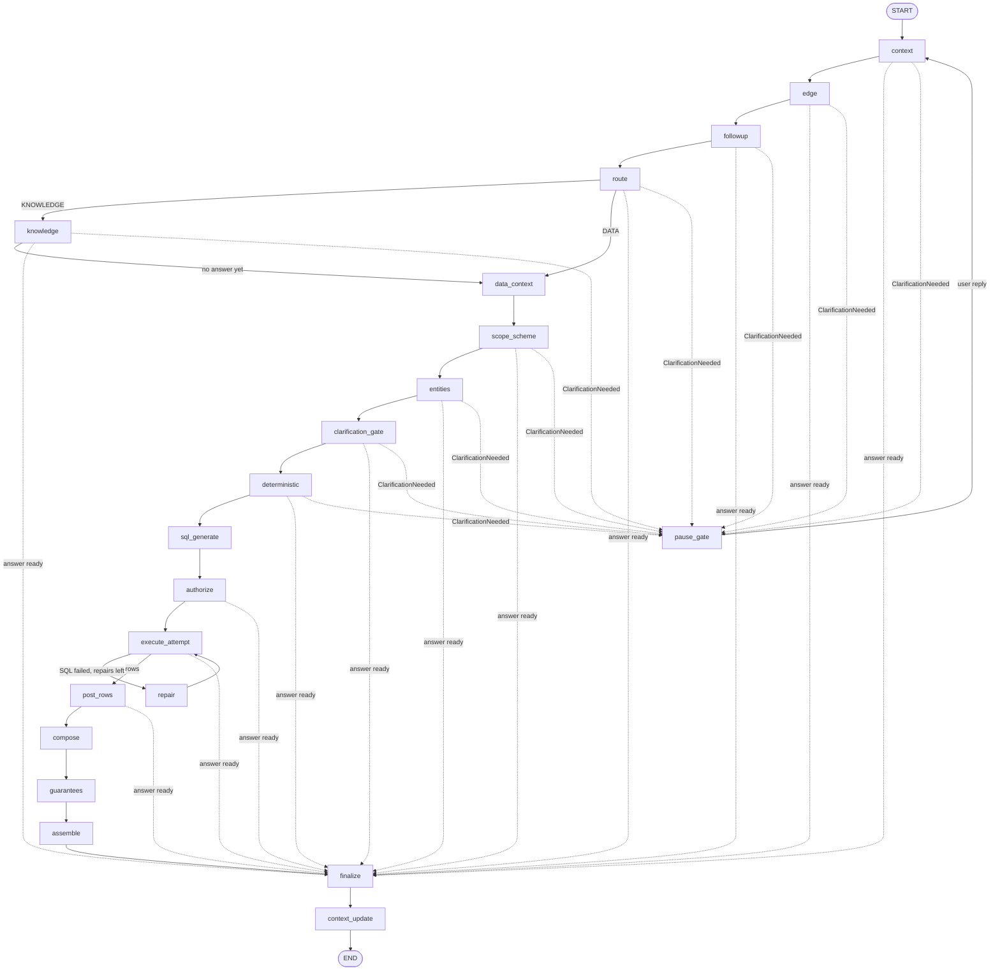

# LangGraph in the Meghalaya NL Assistant: how it works

This document explains how the LangGraph orchestrator is built in the `meghalaya` project and how a
question travels through it, node by node: from the user's question, through database search, to
the final answer. It also covers state, checkpointing, latency, efficiency and every configuration
field.

All file references are relative to the `meghalaya/` project folder.

---

## 0. Read this first: is LangGraph actually running?

**Yes.** LangGraph is the **default orchestrator**. It is switched on in three places, so it stays on
even if one of them is missing:

| Where | Setting |
|---|---|
| `app/config.py` (code default) | `PIPELINE_GRAPH_ENABLED: bool = True` |
| `meghalaya/.env` and `.env.example` | `PIPELINE_GRAPH_ENABLED=true` |
| `Dockerfile` (`ENV`) and `docker-compose.yml` (`environment:`) | `PIPELINE_GRAPH_ENABLED=true` |

Every request runs through `pipeline_graph.answer_question_via_graph`. The old sequential driver
(`pipeline._run_pipeline`) is kept only as the rollback path.

To roll back to the sequential driver, set this in `.env` (or the shell, for Docker Compose) and restart:

```env
PIPELINE_GRAPH_ENABLED=false
```

With the graph off, `PIPELINE_GRAPH_CANARY_PERCENT=10` sends 10% of sessions (sticky per session) to it.

Both orchestrators run **the same stage functions** and return the same answers, so switching is safe
and reversible (see §12, "Rollout status and rollback").

---

## 1. The big picture

### 1.1 Before and after

**Before (the "context window" pipeline).** One long function, `_run_pipeline` in `app/pipeline.py`,
ran every step in order: read the conversation context, check edge cases, rewrite a follow-up,
classify intent, then either answer from documents (RAG) or generate SQL, run it, repair it and
compose an answer.

**Now (LangGraph).** That long function was split, verbatim, into **stage functions**. LangGraph runs
those stages as **21 nodes** connected by **edges**. The conversation-context layer (the "context
window": session state, rolling summary, follow-up rewrite) was **not replaced**. It now runs
*inside* the graph as the first nodes (`context`, `followup`, `data_context`, `context_update`).

```
                    pipeline.answer_question(question, session, scope)
                                   │
          PIPELINE_GRAPH_ENABLED / canary? ──yes──► pipeline_graph.answer_question_via_graph
                   │ no                                       │  (LangGraph: nodes, edges,
                   ▼                                          │   interrupt, checkpoint)
       _run_pipeline (sequential driver)                      │
                   │                                          │
                   └──────────────►  the SAME stage functions ◄┘
                    _turn_*_stage · _data_*_stage · _scheme_sql_rewrites ·
                    _execute_one_attempt · _repair_sql · _data_path_error_result ·
                    _attach_followups · _update_context
```

### 1.2 What LangGraph does here, and what it does not do

LangGraph owns **orchestration only**:

1. the order of the stages, as explicit nodes and edges;
2. one structured log record per node (data shapes and timings, never the data itself);
3. the SQL repair loop as an explicit `execute_attempt → repair → execute_attempt` cycle;
4. a clarification question ("Which district?") as a real pause, `interrupt()`, saved in a checkpoint
   and resumed with the user's reply.

LangGraph does **not**:

- call models. Every model call is still the raw `httpx` call in `app/llm.py`. No LangChain model,
  prompt or retriever classes are used;
- hold business logic. A node is a thin wrapper around a stage function in `app/pipeline.py`. **New
  logic always goes into a stage, never into a node**, so the two orchestrators cannot drift apart;
- own the conversation. The Session snapshot in Postgres (`app.conversations.context_state`) is still
  the source of truth for the conversation.

### 1.3 Where the code lives

| File | What it holds |
|---|---|
| `app/pipeline_graph.py` (824 lines) | The graph: state schema, 21 nodes, edges, checkpointer, entry point, pause sweeper |
| `app/pipeline.py` | The stage functions every node calls (`_turn_*_stage`, `_data_*_stage`, …) and the switch `answer_question` |
| `app/routers/query.py` | The HTTP endpoint `POST /api/query`: auth, caches, session sync, error mapping |
| `app/llm.py` | All model calls (classifier, SQL generator, verifier, composer, embedding, reranker) |
| `app/db.py` | The Postgres pool and the read-only SQL runner with its safety checks |
| `app/rag.py` | Document search (Qdrant) for knowledge questions |
| `app/context_manager.py`, `app/session_store.py`, `app/session_sync.py` | Conversation context and its durable storage |
| `app/config.py` | Every setting (§10) |
| `tests/test_pipeline_graph.py` | 33 tests: graph and sequential path give identical results and call counts |
| `meghalaya/docs/LANGGRAPH_*.md` | The original design and rollout notes |

Dependencies (`requirements.txt`): `langgraph>=1.2,<2.0`, `langgraph-checkpoint-sqlite>=3.1,<4.0`,
`langgraph-checkpoint-postgres>=3.1,<4.0`.

---

## 2. A request end to end

```
Browser / API client
   │  POST /api/query  {question, session_id}
   ▼
┌──────────────────────── app/routers/query.py ────────────────────────┐
│ 1. Validate (max length, strip control chars), authenticate → scope  │
│ 2. Load the session; session_sync.sync_in (latest state from Postgres)│
│ 3. Cacheable? (not a follow-up, not a reply to a pending question)   │
│      ├─ exact response cache (Redis / memory)        hit → return    │
│      └─ semantic cache (embedding, cosine ≥ 0.93)    hit → return    │
│ 4. answer_question(...) with a 60 s timeout                           │
│      └─ flag on → answer_question_via_graph  ──► LangGraph (§3–§6)   │
│ 5a. Answer:  add turn to session, persist turn, index for memory,     │
│              sync_out to Postgres, audit log, write caches, metrics   │
│ 5b. ClarificationNeeded: remember the pause on the session, persist,  │
│              sync_out, return {intent: "CLARIFY", options: [...]}     │
│ 5c. Errors:  busy → 503, DB down → 503, timeout → 504,                │
│              unsafe SQL → 500, anything else → 502                    │
└───────────────────────────────────────────────────────────────────────┘
```

Steps 1–3 and 5 happen **outside** the graph and are identical on both orchestrators. A cache hit never
reaches LangGraph at all.

Inside `answer_question_via_graph` (`app/pipeline_graph.py`):

1. Get the compiled graph and checkpointer for this event loop (built once per worker, about 161 ms).
2. `thread_id = session_id` (a session-less call gets a one-off `graph-<uuid>`).
3. Take a per-thread lock, so a double click or two tabs cannot run the same thread twice at once.
4. Read the checkpoint. If the thread is paused, resume it with `Command(resume=question)`. Otherwise
   start from `fresh_turn_state(question)`.
5. Stream the graph to the end (`stream_mode="values"`).
6. If the graph stopped at an `interrupt()`, raise `ClarificationNeeded` with the same fields the
   sequential path would raise. Otherwise delete the thread and return the answer.

---

## 3. The graph

### 3.1 Diagram

```
START → context → edge → followup → route ──KNOWLEDGE──► knowledge ─────────────────────┐
                                           └──DATA──► data_context → scope_scheme       │
   → entities → clarification_gate → deterministic → sql_generate → authorize           │
   → execute_attempt ──SQL failed──► repair ──► execute_attempt   (≤ 3 repairs)         │
          └──rows──► post_rows → compose → guarantees → assemble ───────────────────────┤
                                                                                        ▼
 any node: answer ready ──────────────────────────────────────────────────────►  finalize
 any node: ClarificationNeeded ──► pause_gate [interrupt()] ──resume──► context         │
                                                              finalize → context_update → END
```

The same graph in Mermaid (renders in VS Code with a Mermaid extension, GitHub and recent Bitbucket):



### 3.2 How the edges decide

Every node in the main chain has a **conditional edge** built by `_next(default)`:

```python
if state["pending_clarification"]:  go to "pause_gate"   # a question for the user
elif state["response"] is not None: go to "finalize"     # the answer is ready, stop early
else:                               go to <next node>
```

Three nodes have their own routing:

| After | Rule |
|---|---|
| `route` | pause / finish as above, else `knowledge` if `intent == "KNOWLEDGE"`, else `data_context` |
| `execute_attempt` | pause / finish, else `repair` if `attempt_error` is set, else `post_rows` |
| `repair` | pause / finish, else back to `execute_attempt` |

Fixed edges: `START → context`, `assemble → finalize`, `pause_gate → context`,
`finalize → context_update`, `context_update → END`.

`recursion_limit` is set to **100** (LangGraph's default is 25). The longest path, with all three
repairs, is about 30 steps; a resume adds a second pass.

---

## 4. Node by node

Legend: **Model** = an LLM call through `app/llm.py`. **DB** = a Postgres query (`megh_db`).
"Ends turn" = the node can produce the final answer. "Pauses" = the node can ask the user a question.

### Part A: understanding the turn (all questions)

#### 1. `context` → `_turn_context_stage`
The first node of every turn.
- Corrects scheme spellings and settles which CM Elevate dataset is meant ("CM Elevate" vs
  "CM Elevate Legacy").
- Collects turn facts from the session (previous turn, structured state).
- If the session has a **pending clarification**, decides whether this message *continues* it
  (a chip click, "2023-24", "East Khasi Hills", a typed scheme name) or *abandons* it ("thanks",
  a brand-new question). The result is logged as `pause_outcome`: `continued`, `paused-thread` or
  `abandoned`.
- Decides whether this message continues the conversation at all.
- Model: none. DB: none. Ends turn: no. Pauses: yes (ambiguous reference).
- Writes: `question`, `scope_resumed`, `has_context`, `signals`, `prev`, `pause_outcome`,
  `conversation_context`.

#### 2. `edge` → `_turn_edge_stage`
Handles questions that never need the data pipeline: harmful input, definitions ("what is a
block?"), "which schemes do you have?", scheme recommendation, greetings and small talk.
- Model: occasionally. DB: no. Ends turn: yes. Pauses: yes.

#### 3. `followup` → `_turn_followup_stage`
Turns a follow-up fragment into a standalone question.
- "What about West Garo Hills?" after "Houses sanctioned under PMAY-G in East Khasi Hills in 2023-24"
  becomes "Houses sanctioned under PMAY-G in West Garo Hills in 2023-24".
- Builds a **merge plan** (which filters to keep, replace or drop) and calls `rewrite_followup`.
- Model: **classifier** (`qwen4-deploy`) for the rewrite. DB: no. Ends turn: yes. Pauses: yes
  (`reference-ambiguous`, `swap-measure-unavailable`).
- Writes: `question` (rewritten), `is_followup_rewrite`, `plan`, `thread_state`.

#### 4. `route` → `_turn_route_stage`
Chooses between the two main paths.
- Fixed checks first: bank questions, admin expenditure, unsupported schemes, village search.
- Then `classify_intent(question)`: **DATA** (needs numbers from the database) or **KNOWLEDGE**
  (needs an explanation from documents).
- Model: **classifier** (`qwen4-deploy`). DB: village search only. Ends turn: yes. Pauses: yes.
- Writes: `intent`.

#### 5. `knowledge` → `_turn_knowledge_stage` (KNOWLEDGE path only)
Answers from the reference documents (RAG, `app/rag.py`):
1. Embed the question (local `BAAI/bge-small-en-v1.5`, or `qwen3-embedding` on the gateway).
2. Search Qdrant for the top **12** chunks, filtered by scheme.
3. Rerank them with `qwen3-reranker` and keep the top **8**.
4. Score ≥ 0.84: return the top chunk verbatim. Score ≥ 0.55: compose an answer with the
   **composer** (`qwen35-9b`). Below 0.30: discard.
- Ends turn: yes (the normal outcome). Pauses: yes ("which scheme?", "which Focus?").

### Part B: answering from the database (DATA path)

#### 6. `data_context` → `_turn_data_context_stage`
Works out which filters a DATA follow-up **inherits** from the previous turn (district, block,
village, year), using the merge plan from `followup`.
- Model: no. DB: no. Ends turn: no. Pauses: no.
- Writes: `prior_resolved`, `data_question`.

#### 7. `scope_scheme` → `_data_scheme_stage`
Decides **which scheme(s)** the question is about: MGNREGA, PMAY-G, Focus Plus, Focus Legacy,
CM Elevate, CM Elevate Legacy.
- Scheme gates (unsupported schemes, "which Focus?"), then `classify_scheme`, then re-routes.
- Model: **classifier**. DB: no. Ends turn: yes. Pauses: yes (which scheme, top-N, scheme not held).
- Writes: `schemes`.

#### 8. `entities` → `_data_entity_stage`
Finds the places and years in the question and **resolves them to exact database values**.
1. An LLM extracts mentions: `{"districts": ["ekh", "wgh"], "year": "2017-18"}` (JSON-guided output).
2. `resolve_entities` looks each one up in the database: district, block, village →
   `village_code`, year → `year_key`, assembly constituency. Abbreviations and spelling variants are
   handled.
3. Ambiguity is never guessed. Two villages with the same name → a pause with options.
- Model: **classifier** (entity extraction). DB: **yes** (parametrised lookups via `fetch_rows`).
- Ends turn: no. Pauses: yes (about 25 ambiguity rules, acronym near-miss, a stated amount).
- Writes: `entity_result` (`resolved`, `unresolved`, candidates), `fp_amount`.

#### 9. `clarification_gate` → `_data_clarification_stage`
Asks for missing scope **before** spending a SQL-generation call: which region, which financial year,
which tranche, or whether an overall summary is wanted.
- Model: no. DB: no. Ends turn: yes. Pauses: yes (region, scope, year, tranche).

#### 10. `deterministic` → `_data_deterministic_stage`
Some MGNREGA and PMAY-G questions have a **fixed SQL shape**. For those, the SQL is built in code
and the LLM SQL generator is skipped (faster and exact).
- Model: no. DB: no. Ends turn: yes. Pauses: yes (MGNREGA women's employment year).
- Writes: `mg_admin`, `mg_women`, `mg_det` (the deterministic query, if any).

#### 11. `sql_generate` → `_data_sql_stage`
Writes the SQL.
- If `deterministic` produced a query, use it.
- Otherwise `generate_sql(question, schemes, entity_result)`: the prompt holds the schema of the
  curated views for these schemes, the resolved entity values and few-shot examples.
- Model: **SQL generator** (`qwen-model`, temperature 0, guided by a SQL-shape regex). DB: no.
- Writes: `sql`; resets `sql_attempt = 0`.

#### 12. `authorize` → `_data_authorize_stage`
Checks the SQL against the user's **role scope** (`auth.authorize`). A block officer cannot query
another district or ask for finer data than their posting allows.
- A local regex check: no model, no DB. Ends turn: yes (a "denied" answer).

#### 13. `execute_attempt` → `_scheme_sql_rewrites` + `_execute_one_attempt`
**This is where the database is searched.** One attempt runs:
1. **Deterministic rewrites** (about 35 per-scheme fixes), for example pinning the resolved
   `village_code`, upper-casing geography literals, fixing CM Elevate status columns, converting
   PMAY crore figures to rupees.
2. **Re-authorization** of a *repaired* query (attempt ≥ 1), so a repair cannot widen the scope.
3. **Regex guards**: the query must filter the resolved village, must contain a stated amount, must
   not SUM a producer group's size across payments, and so on. A failed guard raises an error the
   repair model can read.
4. **Semantic verifier**: the **verifier** model (`qwen4-deploy`) judges whether the SQL answers the
   question. An outage of the verifier never blocks an answer.
5. **Execution**: `db.run_readonly(sql)`, which:
   - rejects anything other than a single `SELECT` / `WITH` statement, and any write or DDL keyword;
   - adds `LIMIT 1000` (`SQL_MAX_RESULT_ROWS`) if the query has no limit;
   - runs on the asyncpg pool (10–30 connections) with a 15 s statement timeout.
6. **Post-execution checks** (for example a village's figure that came back as a district total).
- Outcomes:
  - rows returned → `post_rows`;
  - a fixable SQL error and repairs left → `attempt_error` is set → `repair`;
  - DB connection lost → `DatabaseUnavailableError` (HTTP 503, never a misleading "no data");
  - 3 repairs already spent → the error map (§7) gives a knowledge-base fallback answer.
- Writes: `sql`, `rows`, `attempt_error`.

#### 14. `repair` → `_repair_sql`
Sends the failed SQL **and the exact error** back to the SQL generator with the full schema context
and a targeted hint (for example "column X does not exist, use Y").
- Model: **SQL generator** (`qwen-model`). DB: no.
- Writes: `sql` (new), `sql_attempt + 1`. Then back to `execute_attempt`.
- At most **3** repairs (`MAX_SQL_REPAIRS`), so at most 4 SQL executions per question.

#### 15. `post_rows` → `_data_post_rows_stage`
Prepares the rows for the answer: premise checks ("you said 1.71 lakh, the data says 1.52 lakh"),
notes, and fully deterministic answers where a sentence can be built straight from the rows.
- Model: no. DB: sometimes (recounts). Ends turn: yes.
- Writes: `notes`, `rows`.

#### 16. `compose` → `_data_compose_stage`
Writes the natural-language answer from the rows: `compose_response(question, sql, rows, notes)`.
- Model: **composer** (`qwen35-9b`, max 800 tokens, 20 s timeout).
- **Numeric faithfulness guard**: every number in the composed sentence is checked against the
  result rows. A number that is not in the data triggers one strict retry, then a deterministic
  sentence built from the rows. A government dashboard cannot show "17098" for 170981.
- Writes: `answer`.

#### 17. `guarantees` → `_data_guarantees_stage`
Per-scheme rules the answer must satisfy (for example, totals must be stated, units must match).
Model: no. DB: no.

#### 18. `assemble` → `_data_assemble`
Builds the response dict the UI expects: `answer`, `sql`, `rows` / `data`, `schemes`,
`resolved_entities`, `row_count`, chart data. Always goes to `finalize`.

### Part C: finishing the turn

#### 19. `pause_gate` (no stage, `interrupt()` only)
Reached when any node raised `ClarificationNeeded`. It calls `interrupt(payload)` and the run stops;
the checkpoint is written. See §6.

This node deliberately holds **nothing but `interrupt()`**. LangGraph re-runs a paused node from its
start on resume. If the expensive node (`entities`, with its LLM and DB calls) paused itself, every
resume would repeat that work. The expensive node only *records* the pause in
`pending_clarification`; this cheap node does the pausing.

#### 20. `finalize`
- DATA answers: records the standalone question that was answered (`rewritten_question`).
- Adds "Next steps" suggestions (`follow_up_options`) to data and knowledge answers.

#### 21. `context_update` → `_update_context`
Folds this turn into the session's structured state (`context_manager.update_state`) and refreshes
the rolling conversation summary (`maybe_update_summary`, one **classifier** call, max 60 words).
Sets `done = True`. The router then saves the session to Postgres (`sync_out`).

### 4.1 Summary table

| # | Node | Model call | DB | Ends turn | Pauses |
|---|---|---|---|---|---|
| 1 | `context` | – | – | – | ✓ |
| 2 | `edge` | sometimes | – | ✓ | ✓ |
| 3 | `followup` | classifier (rewrite) | – | ✓ | ✓ |
| 4 | `route` | classifier (intent) | village search | ✓ | ✓ |
| 5 | `knowledge` | embedding, reranker, composer | Qdrant | ✓ | ✓ |
| 6 | `data_context` | – | – | – | – |
| 7 | `scope_scheme` | classifier (scheme) | – | ✓ | ✓ |
| 8 | `entities` | classifier (extraction) | ✓ lookups | – | ✓ |
| 9 | `clarification_gate` | – | – | ✓ | ✓ |
| 10 | `deterministic` | – | – | ✓ | ✓ |
| 11 | `sql_generate` | SQL generator | – | – | – |
| 12 | `authorize` | – | – | ✓ (denied) | – |
| 13 | `execute_attempt` | verifier | ✓ **the query** | ✓ (error map) | – |
| 14 | `repair` | SQL generator | – | – | – |
| 15 | `post_rows` | – | sometimes | ✓ | – |
| 16 | `compose` | composer (+1 retry) | – | – | – |
| 17 | `guarantees` | – | – | – | – |
| 18 | `assemble` | – | – | ✓ | – |
| 19 | `pause_gate` | – | – | – | ✓ |
| 20 | `finalize` | – | – | – | – |
| 21 | `context_update` | classifier (summary) | – | – | – |

**No pause is ever raised after SQL generation.** All questions to the user come before the
expensive SQL work.

---

## 5. Graph state (`MeghalayaGraphState`)

The state is a `TypedDict` that each node reads and partly updates. Each node returns **only the keys
it changed**. It holds **plain data only** (strings, numbers, lists, dicts) so it can be checkpointed.

| Group | Key | Meaning |
|---|---|---|
| Request | `raw_question` | As typed (the reply, on a resume) |
| | `question` | The question being answered (spelling fixed, follow-up rewritten) |
| | `session_id`, `thread_id` | `thread_id = session_id` |
| | `resumed` | This run continued a paused thread |
| Context | `conversation_context` | Session state at the start of the turn (read-only copy) |
| | `pause_outcome` | `None` / `continued` / `paused-thread` / `abandoned` |
| | `cm_pinned`, `scope_resumed`, `village_hint` | Turn facts from `context` |
| | `prev` | The previous turn (the antecedent of a follow-up) |
| | `paused_state`, `thread_state`, `thread_is_session` | The conversation state a follow-up continues |
| | `signals`, `has_context` | Whether the message continues the conversation |
| | `plan` | The merge plan: `kind`, `actions`, `reasons` |
| | `is_followup_rewrite` | The question was rewritten from a fragment |
| | `intent` | `DATA` or `KNOWLEDGE` |
| | `prior_resolved` | Filters a DATA follow-up inherits |
| DATA | `data_question`, `data_village_hint` | The question as the DATA path sees it |
| | `schemes` | e.g. `["PMAY-G"]` |
| | `fp_amount` | A stated amount ("more than ₹50,000") |
| | `entity_result` | Resolved districts / blocks / `village_code` / `year_key` |
| | `mg_admin`, `mg_women`, `mg_det` | MGNREGA / PMAY-G deterministic query info |
| | `sql`, `sql_attempt`, `attempt_error` | The query, repairs so far (0–3), the last error |
| | `rows`, `notes` | Query result (keeps `Decimal` / `date` exactly) and premise notes |
| | `style`, `fl_total`, `fl_unplaced`, `fl_breakdown` | Answer style and Focus Legacy breakdowns |
| | `answer` | The composed sentence |
| Outcome | `response` | The final result dict |
| | `response_origin` | `turn` / `data` / `data_error` |
| | `pending_clarification` | `{question, options, rule, village_hint, node}` when pausing |
| | `context_after` | Session state after `context_update` |
| | `done` | `True` after `context_update` |
| | `trace` | One `{node, ms, outcome}` entry per node (append-only reducer) |

Design rules:

- **Every turn starts from `fresh_turn_state()`**, which resets every key, so nothing from an
  earlier run (SQL, rows, a pause) leaks into the next.
- **Live objects stay out of the state.** The `Session` and the user's `UserScope` travel in
  LangGraph's **runtime context** (`GraphContext`), which is never checkpointed. A resumed run is
  authorized with the *resuming* request's scope, never a stored one.
- **Dataclasses become dicts.** `Turn`, `ConversationState`, `MergePlan` and `StatedAmount` are
  stored as dicts and rebuilt inside each node (`_hydrate_*` / `_dehydrate_*`).

---

## 6. Clarification pause and resume

```
Request 1: "How many applications under CM Elevate?"
  clarification_gate raises ClarificationNeeded("Which district?", options=[...], rule=...)
  wrapper stores it in state.pending_clarification
  edge → pause_gate → interrupt(payload)                  ← checkpoint written (thread_id = session_id)
  adapter raises ClarificationNeeded (same fields)
  router: remembers the pause on Session.pending_*, saves to Postgres, returns intent "CLARIFY"

Request 2: "East Khasi Hills"
  router: not cacheable (a pause is pending) → answer_question
  adapter: the checkpoint has an interrupt → astream(Command(resume="East Khasi Hills"))
  pause_gate: interrupt() returns the reply → returns fresh_turn_state(reply, resumed=True)
  edge → context: the existing logic merges the reply into the paused question
  … continues as a normal turn → finalize → context_update → END
  adapter: no interrupt left → deletes the thread → returns the answer
```

What `context` does with the reply:

| Reply | `pause_outcome` |
|---|---|
| "2023-24", "East Khasi Hills", a chip click, a typed scheme or option | `continued` (merged into the paused question) |
| A measure with no matching chip after an option pause | `paused-thread` (continues the paused scheme) |
| "thanks", "hello", "never mind" | `abandoned` (answered as small talk) |
| A brand-new question ("What is CM Elevate?") | `abandoned` (answered fresh) |

**The pause is stored twice, and correctness never depends on the checkpoint.** The pending pause
lives in the Session snapshot in Postgres *and* in the LangGraph checkpoint. If the checkpoint is
missing (the reply landed on the other VM, the thread expired, the flag was flipped), a fresh run
starts, `context` finds `Session.pending_*`, and the answer is the same.

---

## 7. Errors

The node wrapper `_observed` catches errors so both orchestrators behave the same:

| Where | What happens |
|---|---|
| Any node raises `ClarificationNeeded` | Stored as `pending_clarification` → `pause_gate` |
| DATA node: `OutOfScope` | A polite "outside the Megh One AI scope" answer |
| DATA node: 3 repairs spent, or another error | Knowledge-base fallback answer |
| DATA node: model busy / gateway timeout / HTTP 5xx | Re-raised → router returns **503 / 504** |
| DATA node: database unreachable | `DatabaseUnavailableError` → **503** "please retry" |
| `context`, `edge`, `followup`, `route`, `knowledge` | Re-raised to the router unchanged |
| The final checkpoint write fails after `context_update` | The answer is still returned; a warning is logged |

---

## 8. Checkpointing and runtime

| Item | Detail |
|---|---|
| Thread key | `thread_id = session_id` |
| Default backend | SQLite file `logs/langgraph_checkpoints.sqlite` (WAL mode, `busy_timeout=5000`, `synchronous=NORMAL`) |
| Shared backend | `PIPELINE_GRAPH_CHECKPOINTER_DSN=postgres` (reuses `DATABASE_URL`) or a `postgresql://` DSN. Pool of 1–4 connections, tables created in the `app` schema. **Not yet verified (KI-185).** |
| Fallback | If the backend cannot open: in-process memory, with a warning |
| Windows note | psycopg async cannot run on the Windows Proactor loop, so on a Windows dev box a Postgres DSN falls back to SQLite |
| Writes | `PIPELINE_GRAPH_DURABILITY=exit`: one write per run (at the pause or the end). `async` / `sync`: one write per node (for crash forensics) |
| Lifetime | A finished run's thread is **deleted**; only paused threads persist |
| Clean-up | `sweep_loop` (started in `app/main.py`) runs every 600 s and deletes paused threads older than 1,800 s |
| Serializer | `JsonPlusSerializer(pickle_fallback=True)`, so `Decimal` and `date` values in rows round-trip exactly |
| Compiled graph | Built once per worker event loop (`_runtime()`); about 161 ms on first use |
| Concurrency | One `asyncio.Lock` per thread within a worker. Across workers, the Session's stale-revision guard keeps the newer state |

---

## 9. Performance, latency and efficiency

### 9.1 What LangGraph adds

The graph makes **no extra model or database calls**. The tests assert identical model and DB call
counts per conversation on both paths, including across a pause and resume.

It adds orchestration time. Measured 2026-10-02 on the Windows dev box with the model and DB stubbed
at zero latency (pure orchestration cost, p50 per turn):

| Turn type | Sequential | Graph, in-memory | Graph, SQLite (default) | Added by the graph |
|---|---|---|---|---|
| Data answer | 95.8 ms | 142.2 ms | 168.5 ms | **+73 ms** |
| Follow-up (rewrite + merge) | 407.5 ms | 441.5 ms | 528.9 ms | **+121 ms** |
| Clarification pause | 18.6 ms | 49.1 ms | 62.3 ms | **+44 ms** |
| Pause reply (resume) | 16.6 ms | 73.2 ms | 96.7 ms | **+80 ms** |
| Once per worker: compile + open SQLite | – | – | 161 ms | once |

Where the time goes in a data turn: most of it is the stage work itself (the same on both paths);
about **50 ms** is LangGraph's per-step machinery (≈2.9 ms × ~18 steps); the rest is SQLite
checkpoint I/O (one read for the pause lookup, one write, one thread delete).

**In context:** a real live turn takes about **1.70 s at p50 and 3.12 s at p95** (live context suite,
2026-09-29), almost all of it model calls. The graph adds roughly **3–7 %** at p50, and less on slow
turns. Live latency on the graph path has **not** been measured yet; do that during the canary by
comparing `pipeline_graph_run.ms` with `/metrics`.

### 9.2 Where a real turn spends its time

A typical DATA question makes these model calls:

| Step | Model | Timeout |
|---|---|---|
| Follow-up rewrite (follow-ups only) | `qwen4-deploy` (classifier) | 30 s |
| Intent | `qwen4-deploy` | 30 s |
| Scheme | `qwen4-deploy` | 30 s |
| Entity extraction | `qwen4-deploy` | 30 s |
| SQL generation (skipped for deterministic queries) | `qwen-model` | 30 s |
| SQL verifier | `qwen4-deploy` | 15 s |
| SQL repair (0–3 times, only on failure) | `qwen-model` | 30 s each |
| Answer composition (+1 retry if a number is wrong) | `qwen35-9b` | 20 s |
| Conversation summary | `qwen4-deploy` | 30 s |

Plus database work: entity lookups and one to four SQL executions (15 s statement timeout each).
The whole request has a hard ceiling of **60 s** (`REQUEST_TIMEOUT_SECONDS`).

### 9.3 Efficiency features already in place

| Feature | Effect |
|---|---|
| Exact response cache (Redis or memory, 15 min) | A repeated question skips the graph entirely |
| Semantic cache (cosine ≥ 0.93, 15 min, 1,000 entries) | A near-identical question skips the graph |
| Deterministic MGNREGA / PMAY-G queries | No SQL-generation call for fixed-shape questions |
| Clarifications before SQL | No SQL is generated for a question that is still ambiguous |
| `pause_gate` holds only `interrupt()` | A resume never repeats LLM or DB work |
| Model concurrency gate (24 slots, 20 s queue) | Overload returns 503 quickly instead of piling up |
| DB pool (10–30 connections) | No connection set-up per query |
| `LIMIT 1000` on generated SQL | Bounded result size |
| Checkpoint write only at exit | One write per run instead of one per node |
| Finished threads deleted | The checkpoint store stays small |

### 9.4 Levers not taken (each trades away something)

- Fewer, coarser nodes: less per-step overhead, but less detailed logs.
- The in-memory checkpointer: about −25 ms, but a pause no longer survives a worker restart.
- Skipping the per-request pause lookup.

---

## 10. Configuration fields

### 10.1 LangGraph settings (`app/config.py`, set in `.env`)

| Field | Default | Meaning |
|---|---|---|
| `PIPELINE_GRAPH_ENABLED` | `true` | Every request runs on the graph; `false` = sequential driver (rollback) |
| `PIPELINE_GRAPH_CANARY_PERCENT` | `0` | Only used when the graph is off: this percentage of **sessions** runs on the graph (CRC32 of the session id, so a conversation never switches orchestrator mid-thread) |
| `PIPELINE_GRAPH_CHECKPOINTER_DSN` | `""` | Empty = SQLite; `postgres` = reuse `DATABASE_URL`; `postgresql://…` = that DB |
| `LANGGRAPH_CHECKPOINT_DIR` | `logs` | Folder for the SQLite checkpoint file |
| `PIPELINE_GRAPH_DURABILITY` | `exit` | `exit` = one write per run; `async` / `sync` = one per node |
| `PIPELINE_GRAPH_KEEP_THREADS` | `false` | Keep finished threads (debug only; grows without bound) |
| `PIPELINE_GRAPH_PAUSE_TTL_SECONDS` | `1800` | Delete an unanswered pause after 30 minutes |
| `PIPELINE_GRAPH_SWEEP_EVERY_SECONDS` | `600` | How often the sweeper runs (minimum 60) |

### 10.2 Related settings that affect the graph

| Field | Default | Meaning |
|---|---|---|
| `REQUEST_TIMEOUT_SECONDS` | `60` | Hard ceiling on one `/api/query` |
| `MODEL_MAX_CONCURRENCY` | `24` | Model calls in flight per worker |
| `MODEL_QUEUE_TIMEOUT_SECONDS` | `20` | Wait for a model slot, then 503 |
| `CLASSIFIER_MODEL` | `qwen4-deploy` | Intent, scheme, entities, rewrite, summary |
| `SQL_GENERATION_MODEL` | `qwen-model` | SQL generation and repair |
| `SQL_VERIFY_MODEL` / `SQL_VERIFY_ENABLED` | `qwen4-deploy` / `true` | Semantic SQL check |
| `RESPONSE_MODEL` | `qwen35-9b` | Answer composition |
| `RESPONSE_MAX_TOKENS` | `800` | Composer output limit |
| `DB_POOL_MIN_SIZE` / `DB_POOL_MAX_SIZE` | `10` / `30` | Postgres pool |
| `SQL_EXECUTION_TIMEOUT_MS` | `15000` | Per query |
| `SQL_MAX_RESULT_ROWS` | `1000` | `LIMIT` added to generated SQL |
| `RESPONSE_CACHE_TTL_SECONDS` | `900` | Exact cache |
| `SEMANTIC_CACHE_ENABLED` / `_THRESHOLD` | `true` / `0.93` | Semantic cache |
| `RAG_TOP_K` / `RAG_RERANK_TOP_N` | `12` / `8` | Knowledge search |
| `CONTEXT_LAYER_ENABLED` / `CONTEXT_STATE_ENABLED` | `true` / `true` | Conversation context (both paths) |
| `FOLLOWUP_SUGGEST_ENABLED` | `true` | "Next steps" suggestions in `finalize` |

`MAX_SQL_REPAIRS = 3` is a constant in `app/pipeline.py`, not a setting.

**Never set `LANGSMITH_TRACING` or `LANGCHAIN_TRACING_V2`** in this deployment. The `langsmith`
package comes with LangGraph, and turning tracing on would send questions and answers to an
external service.

---

## 11. Observability: reading the logs

The graph writes two kinds of log line. **Neither contains question text, SQL or rows**, only
shapes such as `str:57` or `list:3`. A test asserts this.

**`pipeline_graph_node`**, one per node run:

```json
{"event": "pipeline_graph_node", "node": "execute_attempt", "outcome": "repairable",
 "ms": 812.4, "attempt": 0, "thread": "3f9a1c02b7", "request_id": "…",
 "inputs": {"sql": "str:214", "sql_attempt": "num"},
 "outputs": {"rows": null, "attempt_error": "str:96"}}
```

| Field | Values |
|---|---|
| `node` | One of the 21 node names |
| `outcome` | `ok`, `response` (answer ready), `pause`, `repairable`, `data_error`, `error` |
| `ms` | Time spent in the node |
| `inputs`, `outputs` | Shapes of the keys the node read and wrote |
| `attempt` | Repair attempt (for `execute_attempt` / `repair`) |
| `rule` | Why it paused |
| `route` | `data`, `knowledge`, `clarification`, `denied`, … |
| `thread` | SHA-1 prefix of the session id (not the id itself) |

**`pipeline_graph_run`**, one per request:

```json
{"event": "pipeline_graph_run", "outcome": "answer", "route": "data", "resumed": false,
 "pause_outcome": null, "repairs": 1, "ms": 2140.7, "thread": "3f9a1c02b7",
 "path": ["context","edge","followup","route","data_context","scope_scheme","entities",
          "clarification_gate","deterministic","sql_generate","authorize","execute_attempt",
          "repair","execute_attempt","post_rows","compose","guarantees","assemble",
          "finalize","context_update"]}
```

The existing `pipeline_decision`, `prompt_context` and `llm_call` records still come from the stages
and share the same `request_id`.

Useful commands:

```bash
grep pipeline_graph_run  logs/*.log    # one line per request: path, outcome, repairs, ms
grep pipeline_graph_node logs/*.log    # per-node timing and outcome
```

`GET /health` shows `components.pipeline_graph` = `sqlite`, `postgres`, `memory` or
`not-started` when the graph is in use.

---

## 12. Worked examples

**A. Data question:** "How many houses were sanctioned under PMAY-G in East Khasi Hills in 2023-24?"

`context` → `edge` → `followup` (not a follow-up) → `route` (DATA) → `data_context` →
`scope_scheme` (PMAY-G) → `entities` (district = EAST KHASI HILLS, year_key = 2023-24) →
`clarification_gate` (nothing missing) → `deterministic` (fixed-shape query) → `sql_generate`
(uses it) → `authorize` (allowed) → `execute_attempt` (rows) → `post_rows` → `compose` →
`guarantees` → `assemble` → `finalize` → `context_update` → END.

**B. Follow-up:** "What about West Garo Hills?"

`followup` rewrites it to the full question for West Garo Hills; `data_context` inherits the
scheme and year; the rest runs as in A.

**C. Knowledge question:** "What is the eligibility for CM Elevate?"

`context` → `edge` → `followup` → `route` (KNOWLEDGE) → `knowledge` (Qdrant search, rerank,
compose) → `finalize` → `context_update` → END.

**D. Pause and resume:** "How many applications under CM Elevate?"

Run 1: … `clarification_gate` raises "Which district?" → `pause_gate` → interrupt → the UI shows
chips. Run 2 ("East Khasi Hills"): `pause_gate` resumes → `context` merges the reply
(`pause_outcome = continued`) → the full DATA path → answer.

**E. SQL repair:** the first SQL references a column that does not exist.

`execute_attempt` (`outcome = repairable`) → `repair` (the SQL model gets the error) →
`execute_attempt` (rows) → `post_rows` … The run log shows `repairs: 1`.

---

## 13. Rollout status and rollback

| Gate | Status (2026-10-02) |
|---|---|
| G1 Stage refactor changes no behaviour (1,371 tests before and after) | Passed |
| G2 Graph = sequential, offline (`tests/test_pipeline_graph.py`) | Passed |
| G3 Live context suite on the graph (43 checks) | Passed, 43/43 on both paths |
| G4 Live sample across all six schemes | Passed, 36/36 identical turns; OFF-009 49/49 |
| G5 Canary (`PIPELINE_GRAPH_CANARY_PERCENT=10` on one VM) | **Not started** |
| G6 Cross-VM pauses (accept KI-184 or verify Postgres, KI-185) | Open |
| G7 Full rollout (`PIPELINE_GRAPH_ENABLED=true`) | **Not started** |
| G8 Remove the sequential driver | Not planned |

Open issues:

- **KI-184**: with the default SQLite checkpointer, checkpoints are per host. In the 2-VM deploy a
  pause reply that lands on the other VM finds no thread. The answer is still correct (the Session
  snapshot resumes it); only the trace starts fresh.
- **KI-185**: the Postgres checkpointer is written but not verified.

**Rollback:** set `PIPELINE_GRAPH_ENABLED=false` and `PIPELINE_GRAPH_CANARY_PERCENT=0`, then
restart. Nothing else is needed: conversations live in the Session snapshot, which both paths use,
and a pause taken on the graph resumes on the sequential path. The leftover
`logs/langgraph_checkpoints.sqlite` file can be deleted.

---

## 14. Adding a new step

1. Write the logic as a **stage function** in `app/pipeline.py`, and call it from the sequential
   driver as well.
2. Add any new state keys to `MeghalayaGraphState` (plain data only) and to `fresh_turn_state` if
   they must reset each turn.
3. Write `node_x` decorated with `@_observed(name, inputs=…, outputs=…, data=…)`. Return only the
   keys you changed. **Never call `interrupt()` in a node that does model or DB work**; raise
   `ClarificationNeeded` and let `pause_gate` pause.
4. Register it in `NODES` and wire it in `_CHAIN` or `build_graph()`.
5. Update `tests/test_pipeline_graph.py` (the node count is pinned at 21) and run the suite with
   the flag off and on.

---

## 15. Testing

```bash
# from meghalaya/
python -m pytest tests/test_pipeline_graph.py -q                         # graph vs sequential
PIPELINE_GRAPH_ENABLED=true python -m pytest -q                          # whole suite on the graph
PIPELINE_GRAPH_ENABLED=true python tests/live_context_validation.py      # live, needs VPN
```

Note: the `meghalaya/.venv` folder in this copy was created on another machine and points to a Python
install that does not exist here. Create a fresh virtual environment and
`pip install -r requirements.txt` before running the tests.
